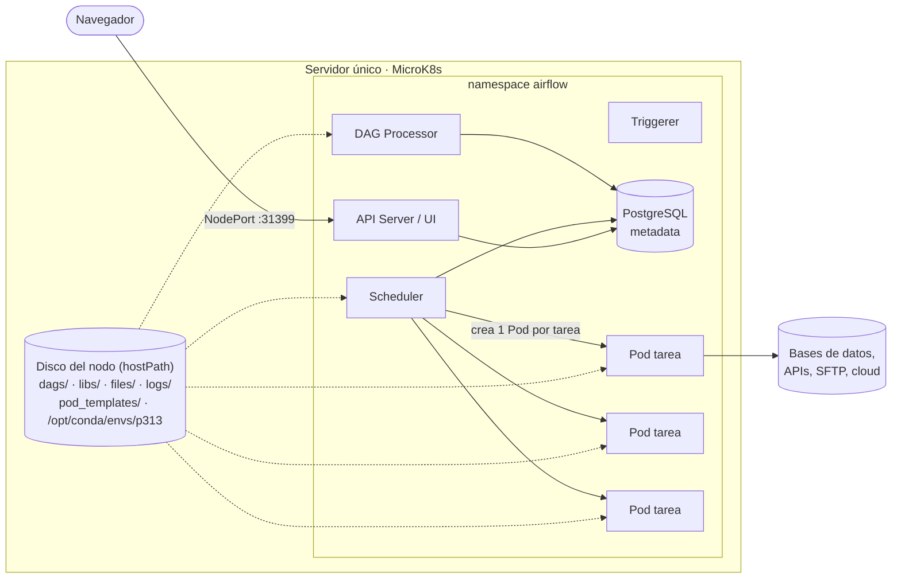

<div align="center">

# Airflow Kubernetes Platform

**Apache Airflow 3 con KubernetesExecutor sobre MicroK8s, lista para producción en un solo servidor.**

Cada tarea corre en su propio Pod efímero, con su propia CPU/RAM y sus propias dependencias. Sin broker ni workers fijos que operar.

[](https://github.com/nrogelki/airflow-kubernetes-platform/actions/workflows/ci.yml)


[](LICENSE)

[Conceptos clave](docs/00-conceptos-clave.md) · [Inicio rápido](#inicio-rápido) · [Arquitectura](docs/01-arquitectura.md) · [Instalación completa](docs/03-instalacion-desde-cero.md) · [Migrar desde Celery](docs/08-migracion-desde-celery.md) · [Documentación](docs/README.md)

</div>

---

## ¿Para quién es?

Para equipos y áreas de datos que usan **Airflow con CeleryExecutor** y quieren
**aislar cada tarea**: que una tarea pesada tenga sus propios recursos sin
sobredimensionar todos los workers, que las dependencias de Python de un DAG no choquen
con las de otro ni con las de Airflow, y operar menos piezas (sin broker, sin Flower,
sin workers fijos).

Este repositorio es una implementación **probada en producción** (decenas de pipelines
ETL diarios) convertida en plantilla reutilizable: clonas, rellenas un archivo de
configuración y despliegas.

> **¿No conoces Kubernetes?** No hace falta para empezar. Lee primero
> [docs/00-conceptos-clave.md](docs/00-conceptos-clave.md) (10 minutos): explica cada
> término con analogías y te dice qué archivo tocar para cada cosa.

## Qué resuelve

| Con CeleryExecutor | Con esta plataforma |
|---|---|
| Workers de larga vida que comparten proceso y estado entre tareas | **Un Pod por tarea**: nace, ejecuta y muere. Sin estado residual |
| Los recursos se definen por worker (todas sus tareas comparten la misma RAM/CPU) | `requests`/`limits` **por tarea**, con override puntual por `executor_config` |
| Dependencias de pandas/numpy chocan con las de Airflow | Código pesado en un **entorno Conda aislado** (`@task.external_python`) |
| Hay que mantener Redis, Flower y N workers | Solo scheduler, dag-processor, api-server, triggerer y PostgreSQL |
| Cambiar librerías = reconstruir imágenes y redeploy | DAGs, librerías y datos se **montan por `hostPath`**: editas y está vivo |
| `pip install` en cada arranque (`_PIP_ADDITIONAL_REQUIREMENTS`) | **Imagen inmutable** importada a containerd: cero descargas en runtime |
| Nadie sabe cuándo algo falla | **Plantillas de alertas** listas: Email, Slack, Teams, Google Chat y webhooks |

## Arquitectura en una imagen



Detalle y ciclo de vida de una tarea: [docs/01-arquitectura.md](docs/01-arquitectura.md).

> **Single-node por diseño.** Todo corre en un servidor. Es simple, barato y no
> necesita registry ni almacenamiento en red, pero tiene implicancias (punto único de
> falla, capacidad acotada al nodo). Léelas antes de adoptar:
> [docs/11-single-node.md](docs/11-single-node.md).

## Inicio rápido

Requisitos: Ubuntu 22.04/24.04 (x86_64), `sudo`, 4+ cores y 16 GB de RAM como
mínimo razonable. Guía paso a paso con explicaciones:
[docs/03-instalacion-desde-cero.md](docs/03-instalacion-desde-cero.md).

```bash
# 0. Clonar en la ruta definitiva del nodo (los hostPath apuntan aquí)
sudo mkdir -p /opt/airflow-platform && sudo chown "$USER" /opt/airflow-platform
git clone https://github.com/nrogelki/airflow-kubernetes-platform.git /opt/airflow-platform
cd /opt/airflow-platform

# 1. Configuración única
make init                      # crea config/platform.env
nano config/platform.env       # PROJECT_PATH, PROJECT_OWNER, SERVER_IP, NODE_PORT...

# 2. Infraestructura (una vez)
make install-microk8s          # MicroK8s 1.35 fijado + addons (ARGS="--docker-fix" si hay Docker)
make install-helm              # Helm 3.19 fijado
make bootstrap                 # grupo developers, carpetas y permisos (UID 50000)
make conda-env                 # entorno aislado p313 para @task.external_python

# 3. Build + deploy
make build                     # imagen inmutable -> containerd de MicroK8s
make deploy                    # render de config + helm upgrade --install
make cronjobs                  # auto-sanación (limpieza de pods + watchdog de Calico)

# 4. Verificar
make doctor
make ui-url                    # abre la UI y ejecuta el DAG example_etl
```

## Estructura del repositorio

```
.
├── config/platform.env.example   ← ÚNICA fuente de configuración (copiar a platform.env)
├── helm/values.template.yaml     ← values del chart oficial (se renderiza a values.yaml)
├── k8s/
│   ├── pod_templates/            ← plantilla del Pod de tarea (+ ejemplo de plantilla de Pod KPO)
│   └── cronjobs/                 ← auto-sanación (Kustomize): limpieza de pods + watchdog de Calico
│       └── scripts/              ← código fuente .sh de cada CronJob + suite de pruebas
├── docker/airflow/               ← imagen inmutable (Dockerfile + requirements livianos)
├── envs/p313/                    ← entorno aislado: environment.yml (fijado) + environment.lock.yml
├── dags/                         ← un directorio por DAG
│   ├── .airflowignore
│   ├── example_etl/              ← ETL de referencia (smoke test)
│   ├── example_alerts/           ← catálogo de alertas: fallo, reintento, éxito
│   ├── example_resource_override/← más CPU/RAM para una sola tarea
│   └── example_kpo/              ← un paso en otra imagen (KubernetesPodOperator, con y sin RBAC)
├── libs/dataplatform/            ← librería compartida (en PYTHONPATH)
│   ├── alerts/                   ← email, Slack, Teams, Google Chat, webhook
│   ├── db/  transfers/           ← Postgres (COPY, engine), SFTP
│   ├── quality/                  ← checks de calidad de datos
│   └── utils/                    ← fechas, reintentos, SQL, DataFrames, archivos
├── files/                        ← datos por DAG (espejo de dags/): inputs + staging
├── scripts/                      ← automatización (instalación, build, deploy, scaffolding)
├── tools/check_dags.py           ← validación estática de DAGs (pre-commit / CI)
├── tests/                        ← pytest + test de render
└── docs/                         ← documentación completa + ADRs
```

## Cómo se ve un DAG

```python
from airflow.sdk import dag, task
from dataplatform.alerts.webhooks import slack_alert

PYTHON_ENV = "/opt/conda/envs/p313/bin/python"  # entorno aislado, montado en el Pod


@task.external_python(python=PYTHON_ENV, expect_airflow=True)
def extract(local_path: str) -> str:
    from dataplatform.utils.local_files import read_json  # libs/ vía PYTHONPATH
    from sales_daily.scripts.etl import extract_to_parquet  # dags/ vía PYTHONPATH (ver nota)

    return extract_to_parquet(local_path, read_json(local_path, "config.json"))  # solo primitivos


@dag(schedule="0 6 * * *", catchup=False, default_args={"on_failure_callback": [slack_alert("slack_alerts")]})
def sales_daily():
    extract("/opt/airflow/files/sales_daily")


sales_daily()
```

> **Nota:** `dags/` ya está en el `PYTHONPATH` del Pod, así que el import funciona tal
> cual. Los DAGs de ejemplo y los que genera `make new-dag` añaden además un *guard*
> defensivo de `sys.path` antes de importar `scripts/`; el porqué está en
> [docs/05](docs/05-desarrollo-de-dags.md).

Crea uno nuevo con la estructura estándar: `make new-dag NAME=sales_daily ARGS='-s "0 6 * * *"'`.
Reglas y patrones: [docs/05-desarrollo-de-dags.md](docs/05-desarrollo-de-dags.md).

## Operación diaria

| Quiero… | Comando |
|---|---|
| Ver el estado | `make status` · `make doctor` |
| Cambiar paralelismo o recursos de componentes | editar `platform.env` → `make deploy` |
| Cambiar recursos del Pod de tarea | editar `platform.env` → `make render && make restart-scheduler` |
| Actualizar librerías de datos | editar `envs/p313/environment.yml` → `make conda-env` → commit del lock |
| Actualizar la imagen | subir `AIRFLOW_IMAGE_TAG` → `make build deploy` |
| Reparar el entorno aislado (paquetes corruptos) | `make repair-env` |
| Probar el watchdog de Calico sin riesgo | `make test-watchdog` |
| Entrar al scheduler | `make shell` |

Todo lo demás: [docs/10-operacion-y-recursos.md](docs/10-operacion-y-recursos.md) ·
[docs/09-troubleshooting.md](docs/09-troubleshooting.md).

## Documentación

| | |
|---|---|
| [00 · Conceptos clave](docs/00-conceptos-clave.md) | **Empieza aquí**: glosario, analogías, qué archivo tocar |
| [01 · Arquitectura](docs/01-arquitectura.md) | Componentes, ciclo de vida de una tarea, montajes |
| [02 · Celery vs Kubernetes](docs/02-celery-vs-kubernetes-executor.md) | Por qué cambiar y cuándo **no** hacerlo |
| [03 · Instalación desde cero](docs/03-instalacion-desde-cero.md) | Runbook completo, en orden |
| [04 · Configuración](docs/04-configuracion.md) | `platform.env`, `values.yaml` y los fixes críticos de Airflow 3 |
| [05 · Desarrollo de DAGs](docs/05-desarrollo-de-dags.md) | PYTHONPATH, `external_python`, reglas y ejemplos |
| [06 · `files/` y permisos](docs/06-files-y-permisos.md) | UID 50000, la causa #1 de fallos |
| [07 · Entornos virtuales](docs/07-entornos-virtuales.md) | Buenas prácticas, por qué Conda y no `venv` |
| [08 · Migración desde Celery](docs/08-migracion-desde-celery.md) | Es mover carpetas: paso a paso con rollback |
| [09 · Troubleshooting](docs/09-troubleshooting.md) | Errores reales y su solución |
| [10 · Operación y recursos](docs/10-operacion-y-recursos.md) | Concurrencia, recursos, monitoreo, backups |
| [11 · Single-node](docs/11-single-node.md) | Implicancias de un solo servidor y seguridad |
| [12 · Alertas](docs/12-alertas.md) | Cómo Airflow resuelve `smtp_default`; Slack/Teams/Chat |
| [13 · Librería `dataplatform`](docs/13-libreria-dataplatform.md) | Referencia de los building blocks |
| [14 · Imágenes dedicadas (KPO)](docs/14-imagenes-dedicadas-kpo.md) | Cuando una tarea necesita otra imagen (p. ej. Kerberos) |
| [15 · Preguntas frecuentes](docs/15-preguntas-frecuentes.md) | Dudas comunes con respuesta corta |
| [CronJobs de auto-sanación](k8s/cronjobs/README.md) | Código fuente, comandos y suite de pruebas |
| [ADRs](docs/adr/) | Decisiones de arquitectura y sus trade-offs |

## Versiones validadas

| Componente | Versión |
|---|---|
| Apache Airflow | 3.2.1 (imagen `apache/airflow:3.2.1-python3.12`) |
| Chart Helm | oficial `apache-airflow/airflow` 1.22.0 (fijado en `AIRFLOW_CHART_VERSION`) |
| MicroK8s | 1.35 (`snap refresh --hold`) |
| Helm | 3.19.2 |
| Entorno aislado | Python 3.13 (Conda) |

## Contribuir

¡Los aportes son bienvenidos! Lee [CONTRIBUTING.md](CONTRIBUTING.md) y el
[Código de Conducta](CODE_OF_CONDUCT.md). Para reportar vulnerabilidades, sigue
[SECURITY.md](SECURITY.md) (no abras un issue público).

## Licencia

[Apache License 2.0](LICENSE). Apache Airflow, Apache y el logo de la pluma son marcas
registradas de la Apache Software Foundation. Este proyecto no está afiliado a la ASF.
