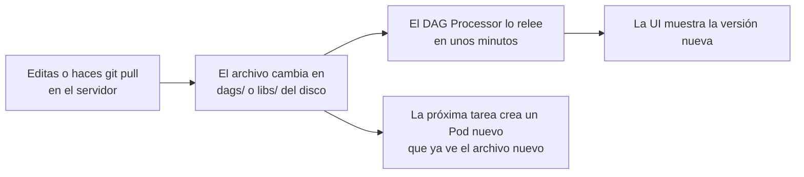

# 00 · Conceptos clave (léelo primero)

Esta página explica, sin asumir que conoces Kubernetes, todo el vocabulario que usa el
resto de la documentación. Si ya manejas Airflow y Kubernetes, salta a
[01-arquitectura.md](01-arquitectura.md).

## 1. La idea en tres frases

1. **Airflow** decide *qué* ejecutar y *cuándo* (tus pipelines, sus horarios y su orden).
2. **Kubernetes** decide *dónde* se ejecuta: por cada tarea crea un contenedor aislado,
   lo corre y lo destruye.
3. **Tu código y tus datos viven en el disco del servidor**. Los contenedores los "ven"
   a través de carpetas compartidas, así que editar un archivo basta para actualizarlos.

## 2. Una analogía para todo el sistema

Piensa en un **edificio de oficinas** (el servidor):

| En el edificio | En la plataforma | Qué es |
|---|---|---|
| El edificio | **Nodo** (el servidor con MicroK8s) | La máquina física o virtual |
| La administración del edificio | **Kubernetes** (MicroK8s) | Asigna oficinas, vigila que funcionen, las limpia |
| Un piso reservado para un área | **Namespace** `airflow` | Agrupa todo lo de Airflow, separado del resto |
| La recepción, que siempre está abierta | **Componentes fijos** (scheduler, api-server...) | Procesos que viven siempre |
| Una sala que se arrienda por una reunión | **Pod de tarea** | Contenedor que nace para una tarea y se destruye al terminar |
| La bodega del edificio | **Disco del nodo** (`dags/`, `libs/`, `files/`, `logs/`) | Lo que debe sobrevivir a las salas |
| Un pasillo de la sala a la bodega | **Volumen `hostPath`** | Carpeta del servidor montada dentro del contenedor |
| El libro de registro | **PostgreSQL** (metadata DB) | Qué corrió, cuándo, con qué resultado, y las credenciales |
| La caja de herramientas pesadas | **Entorno aislado `p313`** | Python con pandas, polars y drivers, separado de Airflow |

**La regla que se deriva:** una sala (Pod) es desechable. Nada importante se deja
adentro: todo lo que debe durar va a la bodega (`files/`, `logs/`) o al registro
(base de datos).

## 3. Glosario de Kubernetes

| Término | Qué es | Dónde lo ves aquí |
|---|---|---|
| **Contenedor** | Un proceso empaquetado con su sistema de archivos (una imagen) | Cada componente de Airflow |
| **Imagen** | La "plantilla" de un contenedor: SO + Python + librerías | `airflow-k8s-base:1.0.0` (`docker/airflow/`) |
| **containerd** | El motor que ejecuta los contenedores dentro de MicroK8s. **No es Docker**: por eso la imagen se construye con Docker y se *importa* | `make build` |
| **Pod** | La unidad mínima que Kubernetes ejecuta: uno o más contenedores | Un Pod por tarea |
| **Deployment** | "Mantén siempre N copias de este Pod vivas" | scheduler, api-server, dag-processor |
| **StatefulSet** | Como un Deployment, pero cada Pod conserva su nombre y su disco propio | triggerer, PostgreSQL |
| **Namespace** | Carpeta lógica que agrupa recursos | `airflow` |
| **Volumen `hostPath`** | Monta una carpeta del servidor dentro del Pod | `dags/`, `libs/`, `files/`, `logs/` y el entorno `p313` (solo lectura, solo en Pods de tarea) |
| **PVC** | Disco persistente solicitado a Kubernetes | Datos de PostgreSQL |
| **Service / NodePort** | Dirección de red estable; NodePort la expone en un puerto del servidor | La UI en `http://IP:31399` |
| **requests / limits** | CPU/RAM *reservada* / *máxima* de un contenedor | `WORKER_*` en `platform.env` |
| **OOMKilled** | El contenedor superó su límite de memoria y el sistema lo mató | [09-troubleshooting](09-troubleshooting.md#oomkilled) |
| **CronJob** | Tarea programada de Kubernetes (como `cron`) | Limpieza de Pods, watchdog de Calico |
| **Calico** | La red interna de Kubernetes (CNI) | El watchdog la vigila |
| **ServiceAccount** | La identidad con la que un Pod habla con la API de Kubernetes | Los Pods de tarea usan `default`; el chart crea `airflow-worker` para lanzar Pods |
| **RBAC** | Permisos: quién (qué ServiceAccount) puede hacer qué en el clúster. **Activado**: solo lo permitido explícitamente. **Desactivado** (`AlwaysAllow`): todo permitido a todos | CronJobs con permisos mínimos; tareas KPO ([14 §3](14-imagenes-dedicadas-kpo.md#3-permisos-con-rbac-y-sin-rbac)) |
| **Helm / chart** | Instalador de aplicaciones en Kubernetes / el "paquete" | Chart oficial de Airflow |
| **`values.yaml`** | La configuración que se le pasa al chart | Se genera desde `helm/values.template.yaml` |
| **kubectl** | La herramienta de línea de comandos para mirar y operar el clúster | `kubectl get pods -n airflow` |

## 4. Glosario de Airflow

| Término | Qué es |
|---|---|
| **DAG** | Un pipeline: tareas y el orden entre ellas. Aquí vive en `dags/<dag_id>/_dag.py` |
| **Tarea (task)** | Un paso del DAG. Con KubernetesExecutor, cada ejecución de una tarea = un Pod |
| **Executor** | El mecanismo que ejecuta las tareas. Aquí: **KubernetesExecutor** (sin Celery ni workers fijos) |
| **Scheduler** | Revisa horarios y dependencias y pide a Kubernetes los Pods |
| **DAG Processor** | Lee tus `_dag.py` y guarda su estructura en la base de datos |
| **API Server** | La interfaz web (UI) y la API por la que los Pods reportan su estado |
| **Triggerer** | Atiende tareas que "esperan" algo sin ocupar un Pod |
| **Parse time / parseo** | El momento en que el DAG Processor *lee* tu `_dag.py`. Ocurre cada pocos minutos, siempre: por eso ahí no debe haber trabajo pesado |
| **Run time** | El momento en que una tarea *se ejecuta* dentro de su Pod |
| **`@task.external_python`** | Ejecuta la función en **otro intérprete de Python** (el entorno `p313`), no en el de Airflow |
| **KubernetesPodOperator (KPO)** | Tarea que, desde su Pod, crea **otro Pod con otra imagen** (otro Python, librerías, compiladores) y espera a que termine. Ver [14](14-imagenes-dedicadas-kpo.md) |
| **XCom** | El mecanismo para pasar valores pequeños entre tareas (rutas, conteos). **No** DataFrames |
| **Connection (`conn_id`)** | Credenciales guardadas cifradas en Airflow (Admin → Connections). El código solo usa su nombre |
| **Pool** | Límite de tareas simultáneas para un grupo (p. ej. máx. 2 contra una base frágil) |
| **`ds` / `logical_date`** | La fecha "de negocio" de una corrida (el día que procesa), no la fecha actual |
| **Callback** | Función que Airflow llama al fallar, reintentar o terminar una tarea: así funcionan las alertas |
| **Catchup** | Si Airflow debe ejecutar las corridas atrasadas. Aquí por defecto `False` |

### Formatos de archivo

| Término | Qué es |
|---|---|
| **CSV** | Una tabla en texto plano, con columnas separadas por comas. Se abre en Excel o en cualquier editor. No guarda el tipo de cada columna: al leerlo, fechas y números vuelven como texto y hay que reinterpretarlos |
| **Parquet** | Un formato de archivo para tablas pensado para datos: como un CSV, pero guarda el tipo de cada columna (fechas, números, vacíos), viene comprimido (suele pesar varias veces menos) y polars/pandas lo leen mucho más rápido. No se abre en Excel. Se escribe con `df.write_parquet(ruta)` y se lee con `pl.read_parquet(ruta)` |

## 5. Qué archivo toco para qué

| Quiero… | Toco | Y luego |
|---|---|---|
| Crear un pipeline | `make new-dag NAME=...` | Escribir `scripts/` y `_dag.py` |
| Cambiar la lógica de un pipeline | `dags/<dag_id>/scripts/*.py` | Nada: se usa en la próxima ejecución |
| Cambiar horario u orden de tareas | `dags/<dag_id>/_dag.py` | Nada: se relee en unos minutos |
| Cambiar un archivo de configuración de un pipeline | `files/<dag_id>/*.json` | Nada (ojo con los permisos: [06](06-files-y-permisos.md)) |
| Agregar una utilidad para varios pipelines | `libs/dataplatform/` | Nada, más un test en `tests/` |
| Agregar pandas, polars o un driver | `envs/p313/environment.yml` | `make conda-env` + commit del lock |
| Dar más RAM a **una** tarea | `executor_config` en esa tarea | Nada |
| Dar más RAM a **todas** las tareas | `WORKER_*` en `config/platform.env` | `make render && make restart-scheduler` |
| Correr más tareas a la vez | `PARALLELISM` en `config/platform.env` | `make deploy` |
| Agregar credenciales | UI → Admin → Connections | Nada |
| Recibir alertas | `on_failure_callback` en el DAG | Crear la Connection ([12](12-alertas.md)) |

**Regla mnemónica:** DAGs, librerías y datos están en el disco, así que el cambio es
inmediato. Lo que pasa por Helm (`values.yaml`) requiere `make deploy`.

## 6. Cómo viaja un cambio

No hay que construir imágenes, reiniciar ni desplegar. La excepción es la
infraestructura (`platform.env`, imagen, entorno), explicada en la tabla anterior.

## 7. Los tres errores de principiante (y cómo evitarlos)

1. **Importar librerías de datos arriba del `_dag.py`** (pandas, polars, drivers). Ahí se
   cargan con la imagen de Airflow, no con el entorno `p313`: si la librería no está en la
   imagen (polars, por ejemplo) el DAG desaparece de la UI con un error de importación, y si
   está, puede ser otra versión y además se carga en cada parseo. Los imports pesados van
   **dentro** de las tareas `@task.external_python`. `make check-dags` lo detecta.
2. **Pasar un DataFrame de una tarea a otra.** Cada tarea es un Pod distinto: guarda el
   DataFrame como **archivo** (Parquet o CSV) en `files/<dag_id>/` y pasa **la ruta**.
3. **Crear archivos en `files/` con tu usuario.** Los Pods corren como UID 50000 y no
   pueden modificarlos. Usa `make new-dag` o
   `sudo chown 50000:developers <archivo>` ([06](06-files-y-permisos.md)).

## 8. ¿Y ahora qué leo?

- Para entender el diseño completo: [01-arquitectura.md](01-arquitectura.md)
- Para instalarlo: [03-instalacion-desde-cero.md](03-instalacion-desde-cero.md)
- Para escribir DAGs: [05-desarrollo-de-dags.md](05-desarrollo-de-dags.md)
- Si tienes una duda puntual: [15-preguntas-frecuentes.md](15-preguntas-frecuentes.md)
