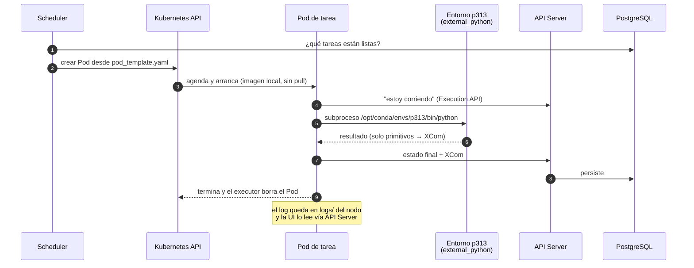
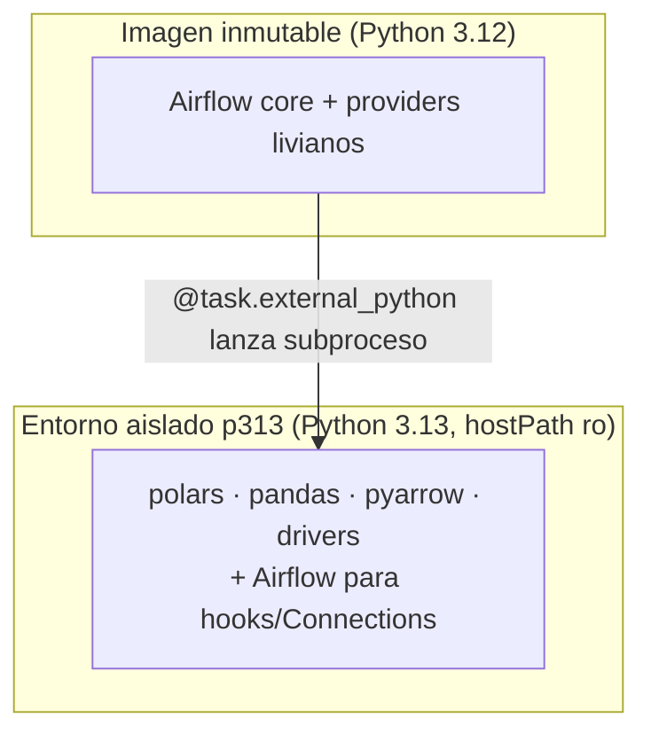

# 01 · Arquitectura

> Pocos componentes fijos y muchos Pods de vida corta.

## 1. Piezas

| Componente | Tipo | Rol | Monta del disco |
|---|---|---|---|
| **Scheduler** | Deployment | Decide qué tarea toca y le pide a Kubernetes su Pod | `dags/`, `libs/`, `files/`, `pod_templates/` |
| **DAG Processor** | Deployment | Parsea los `_dag.py` y guarda el DAG serializado en PostgreSQL | `dags/`, `libs/`, `files/` |
| **API Server** | Deployment | UI + REST API + *Execution API* (los Pods reportan su estado aquí) | `logs/` (para la pestaña Logs) |
| **Triggerer** | StatefulSet | Atiende operadores *deferrable* sin ocupar un Pod | — |
| **PostgreSQL** | StatefulSet | Metadata DB: DAGs, corridas, estados, Connections cifradas | PVC (`microk8s-hostpath`) |
| **Pod de tarea** | Pod efímero | Ejecuta **una** tarea y muere | `dags/`(ro) `libs/`(ro) `files/` `logs/` `envs/p313`(ro) |

No hay Redis, Flower ni workers de Celery.

## 2. Ciclo de vida de una tarea



Puntos clave:

1. **El Pod es desechable.** Todo lo que deba sobrevivir vive fuera: en `files/`, en
   `logs/` o en una base de datos.
2. **La imagen no se descarga.** `imagePullPolicy: Never`: el arranque depende solo del
   nodo, no de internet ni de un registry.
3. **El trabajo pesado no corre en el proceso de Airflow**, sino en un subproceso con el
   intérprete del entorno aislado. Airflow solo supervisa.

## 3. Inyección de código por `hostPath`

El código **no** se hornea en la imagen ni se sincroniza con git-sync: se monta desde el
disco del nodo.

```
PROJECT_PATH (p. ej. /opt/airflow-platform)
├── dags/               → /opt/airflow/dags            (scheduler, dag-processor, tareas[ro])
├── libs/               → /opt/airflow/libs            (scheduler, dag-processor, tareas[ro])
├── files/              → /opt/airflow/files           (scheduler, dag-processor, tareas)
├── logs/               → /opt/airflow/logs            (api-server, tareas)
└── k8s/pod_templates/  → /opt/airflow/pod_templates   (scheduler, tareas)
CONDA_ENVS_HOST_PATH/p313 → /opt/conda/envs/p313       (solo tareas, ro)
```

**Por qué:** un `git pull` en el nodo (o editar un archivo) actualiza DAGs y librerías en
el siguiente parseo, sin reconstruir imágenes ni hacer `helm upgrade`. Es posible
**porque hay un solo nodo** (ver [11-single-node.md](11-single-node.md)).

**Mínimo privilegio:** cada componente monta solo lo que usa. El API Server no monta
`dags/` (en Airflow 3 lee los DAGs serializados desde PostgreSQL), pero sí `logs/`, porque
es quien sirve la pestaña Logs ([fix](09-troubleshooting.md#logs-vacíos-en-la-ui)).

## 4. Tres dominios de código

| Dominio | Dónde | Qué va | Estilo |
|---|---|---|---|
| Orquestación | `dags/<dag_id>/_dag.py` | Definición del DAG y tareas delgadas | Imports de `libs/` y `scripts/` **dentro** de las tareas |
| Lógica del pipeline | `dags/<dag_id>/scripts/` | Lo exclusivo de ese DAG | Python normal |
| Building blocks | `libs/dataplatform/` | Lo que usan 2+ DAGs | Python normal, agnóstico del negocio |

Más `files/<dag_id>/` para **datos** (inputs y staging) y `dags/<dag_id>/sql/` para
consultas. Detalle en [05-desarrollo-de-dags.md](05-desarrollo-de-dags.md).

## 5. Dos niveles de dependencias



- **Imagen:** lo que necesitan scheduler y dag-processor para *parsear*. Cambia poco;
  cada cambio es un tag nuevo.
- **Entorno aislado:** lo que necesitan las tareas para *procesar*. Se actualiza sin
  tocar la imagen. Ver [07-entornos-virtuales.md](07-entornos-virtuales.md).

## 6. Auto-sanación

Dos CronJobs en [`k8s/cronjobs/`](../k8s/cronjobs/):

- **`pod-cleaner`** (namespace `airflow`, cada 10 min): borra Pods `Failed`/`Evicted` y
  atascados >10 min en `ImagePullBackOff`, `CrashLoopBackOff`, etc. RBAC limitado al
  namespace.
- **`calico-watchdog`** (`kube-system`, cada 5 min): si Calico pierde su token
  (`plugin type="calico" failed ... Unauthorized`), reinicia el DaemonSet. Usa
  `hostNetwork` (para arrancar aun con la red caída), ventana de eventos de 15 min y
  *cooldown* de 1 h contra bucles. Tiene `DRY_RUN` para probarlo.

## 7. Decisiones de arquitectura

Las razones y alternativas descartadas están en los ADR:
[0001 KubernetesExecutor](adr/0001-kubernetes-executor.md) ·
[0002 hostPath](adr/0002-inyeccion-de-codigo-por-hostpath.md) ·
[0003 entornos aislados](adr/0003-entornos-aislados-external-python.md) ·
[0004 single-node](adr/0004-single-node-microk8s.md).
