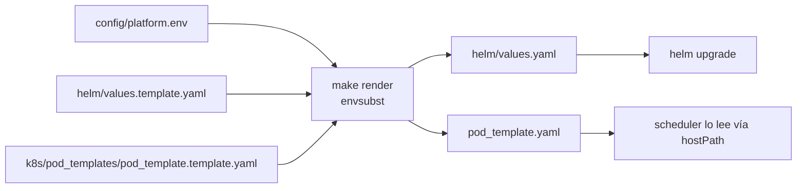

# 04 · Configuración

## 1. Un solo archivo: `config/platform.env`

Toda la configuración específica de tu servidor vive en `config/platform.env` (copia de
[`platform.env.example`](../config/platform.env.example), **ignorado por git**). Las
plantillas nunca se editan con valores reales:



Solo se sustituyen las variables declaradas en
[`render_config.sh`](../scripts/render_config.sh); cualquier otro `$` de las plantillas
queda intacto.

## 2. Variables

| Variable | Default | Qué controla | Aplicar con |
|---|---|---|---|
| `PROJECT_PATH` | `/opt/airflow-platform` | Raíz del repo **en el nodo**; base de los hostPath | `make deploy` |
| `CONDA_ENVS_HOST_PATH` | `/opt/conda/envs` | Carpeta de entornos en el host | `make render` + restart |
| `PYTHON_ENV_NAME` | `p313` | Entorno aislado (definido en `envs/p313/environment.yml`) | `make conda-env` |
| `PROJECT_OWNER` / `DEV_GROUP` | `airflow-admin` / `developers` | Dueños de archivos | `make bootstrap` |
| `AIRFLOW_UID` | `50000` | Usuario de los Pods (imagen oficial) | `make bootstrap` |
| `AIRFLOW_NAMESPACE` / `HELM_RELEASE` | `airflow` / `airflow` | Namespace y release | `make deploy` |
| `AIRFLOW_CHART_VERSION` | `1.22.0` | Versión del chart, **fijada** (la validada). Vacío = la última publicada | `make deploy` |
| `AIRFLOW_VERSION` / `AIRFLOW_PYTHON_VERSION` | `3.2.1` / `3.12` | Imagen base | `make build deploy` |
| `AIRFLOW_IMAGE_REPO` / `_TAG` | `airflow-k8s-base` / `1.0.0` | Imagen propia | `make build deploy` |
| `SERVER_IP` / `NODE_PORT` | autodetect / `31399` | URL de la UI (`base_url`) | `make deploy` |
| `WEBSERVER_SECRET_KEY` | autogenerada | CSRF/sesiones | `make deploy` |
| `PARALLELISM` / `MAX_ACTIVE_TASKS_PER_DAG` | `5` / `2` | Concurrencia global / por DAG | `make deploy` |
| `WORKER_*` | 250m/512Mi → 2/8Gi | Recursos del Pod de tarea | `make render` + `make restart-scheduler` |
| `WORKER_ACTIVE_DEADLINE_SECONDS` | `5400` | Vida máxima de un Pod de tarea | `make render` + restart |
| `ALERT_TIMEZONE` | `UTC` | Zona horaria en las alertas | `make deploy` |

**Regla mnemónica:** lo que va en `values.yaml` → `helm upgrade` (`make deploy`). Lo que
va en `pod_template.yaml` → **no** requiere Helm (es hostPath): `make render` +
`make restart-scheduler`.

## 3. Los fixes críticos de Airflow 3 que ya trae `values.template.yaml`

Cada uno viene de un incidente real. **No los quites sin entenderlos.**

### 3.1 Secret key idéntica en tres lugares → evita CSRF y *login loop*

```yaml
webserverSecretKey: "${WEBSERVER_SECRET_KEY}"
config.webserver.secret_key: "${WEBSERVER_SECRET_KEY}"
env: AIRFLOW__WEBSERVER__SECRET_KEY=${WEBSERVER_SECRET_KEY}
```

Si difieren (o el chart genera una aleatoria en cada upgrade), los tokens de sesión y
CSRF firmados por un proceso no validan en otro: errores `CSRF token missing` o sesión
que se cierra sola. Rotarla invalida todas las sesiones abiertas.

### 3.2 `api.workers: "1"` → evita el loop de `401 Unauthorized`

Con varios workers de API, cada proceso mantuvo su propio estado de sesión y la UI
entraba en un bucle de 401. Un worker basta para equipos de decenas de usuarios.

### 3.3 `api.base_url` con IP y NodePort → evita el loop de redirects

Sin la URL externa exacta (`http://SERVER_IP:NODE_PORT`), la UI redirige a una URL
interna y el navegador entra en bucle. También la usan las alertas para armar enlaces.

### 3.4 `execution_api_server_url` exacto

`http://<release>-api-server.<namespace>.svc.cluster.local:8080/execution/`. En Airflow 3
los Pods de tarea reportan su estado por la *Execution API*; un nombre de Service mal
escrito (p. ej. sin guion) deja las tareas colgadas en `queued`/`running`. Se define en
`values.yaml` **y** en el `pod_template` (los Pods no heredan la config del scheduler).

### 3.5 `mp_start_method: "spawn"` → estabiliza el dag-processor

Con `fork`, el dag-processor clonaba memoria al parsear muchos DAGs pesados y entraba en
`CrashLoopBackOff`/`SIGKILL 137`. `spawn` arranca intérpretes limpios.

### 3.6 Probes relajados

- `dagProcessor.livenessProbe`: 30 s de timeout, cada 60 s, 5 fallos.
- `apiServer.startupProbe`: 30 × 10 s = 5 min para arrancar (el default de 60 s mata al
  API server en nodos modestos durante la primera migración).
- `triggerer.livenessProbe`: 40 s / 10 fallos.

### 3.7 `dag_ignore_file_syntax: "regexp"`

`dags/.airflowignore` usa regex (`.*/scripts/.*`) para que el dag-processor **no importe**
la lógica de `scripts/` (que depende de librerías que solo existen en el entorno
aislado). Se fija explícitamente porque el default cambió entre versiones.

### 3.8 NodePort fijo

`apiServer.service.ports[].nodePort: ${NODE_PORT}` evita que el puerto cambie entre
reinstalaciones (y con él, `base_url` y los enlaces de las alertas).

## 4. Personalizaciones frecuentes

Lo que la plantilla no trae resuelto, y dónde se configura en el chart oficial. Las
claves están **verificadas** contra el chart `apache-airflow/airflow` 1.22.0 con
`helm template` (cada una genera lo esperado), pero estas personalizaciones **no** forman
parte de las pruebas de la plataforma: tómalas como punto de partida y revisa la
[documentación del chart](https://airflow.apache.org/docs/helm-chart/stable/) de tu versión.
Una clave mal escrita, Helm la ignora **sin avisar**.

| Quiero… | Dónde (en `helm/values.template.yaml`) | Qué genera |
|---|---|---|
| Autenticación LDAP/OAuth | `apiServer.apiServerConfig` con el contenido de un `webserver_config.py` (FAB). En Airflow 3 **no** es `webserver.webserverConfig`, que es de Airflow 2 | ConfigMap `<release>-api-server-config` montado en el api-server |
| PostgreSQL externo | `postgresql.enabled: false` + `data.metadataConnection` (host, user, pass, db). Mejor: `data.metadataSecretName`, para que la contraseña no quede en `values` | Sin StatefulSet de PostgreSQL; Secret de conexión al host externo |
| Ingress + TLS en vez de NodePort | `ingress.apiServer.enabled: true` + `hosts` con `tls.secretName`. Requiere un ingress controller (`microk8s enable ingress`) y el certificado (p. ej. cert-manager); cambia también `base_url` en `[api]` a la URL https | Ingress `<release>-ingress` |
| Secrets backend (Vault, AWS SM…) | `config.secrets.backend` + `config.secrets.backend_kwargs` (cualquier sección bajo `config:` se vuelve `[sección]` en `airflow.cfg`) | `[secrets]` en `airflow.cfg` |
| Variables de entorno para todo | `env` en `values.template.yaml` **y** en `k8s/pod_templates/pod_template.template.yaml` | `env` del chart llega a api-server, scheduler, dag-processor y triggerer, **pero no a los Pods de tarea** (salen del `pod_template`) |

Para agregar cualquier clave: ponla en `helm/values.template.yaml`. Si su valor cambia por
servidor, agrégala también como variable a `config/platform.env.example` **y** a la lista
`VARS` de `scripts/render_config.sh`: si falta en `VARS`, `make render` la deja sin
reemplazar. Aplica con `make deploy`.
