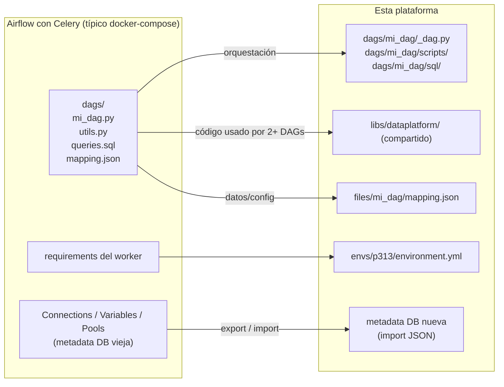

# 08 · Migración desde CeleryExecutor

## La idea central: es mover carpetas

Tus DAGs **no dependen del executor**. Un `PythonOperator` o un `@task` corre igual en
un worker de Celery que en un Pod. Migrar a esta plataforma es, sobre todo,
**reorganizar archivos** en tres carpetas y **mover credenciales** a la nueva metadata DB:



No hay que reescribir la lógica de negocio. Lo que sí cambia es **dónde vive cada
archivo** y, para tareas pesadas, envolverlas en `@task.external_python`.

## Estrategia recomendada: convivencia y corte por DAG

No hagas un *big bang*. Ambos Airflow pueden convivir (servidores distintos, o el mismo
con puertos distintos si hay recursos):

1. Levanta esta plataforma vacía ([03-instalacion-desde-cero.md](03-instalacion-desde-cero.md)).
2. Migra Connections/Variables/Pools (paso 2).
3. Migra **un DAG a la vez**: lo copias, lo validas, lo **pausas en el viejo** y lo
   **activas en el nuevo**. Nunca activo en ambos (duplicarías cargas).
4. Cuando el viejo no tenga DAGs activos, lo apagas. Guárdalo detenido unas semanas
   como rollback.

## Paso 1 — Inventario

```bash
# En el Airflow viejo
airflow dags list -o table
airflow connections list -o table
airflow variables list
airflow pools list
python -m pip freeze > requirements-worker-legacy.txt   # dentro de un worker
```

### Si tu Airflow con Celery corre en contenedores

Los comandos `airflow ...` funcionan en cualquier contenedor de Airflow (scheduler,
webserver o worker): todos leen la misma base de datos. `python -m pip freeze` debe ir en un
**worker**, que es donde corren las tareas y donde están sus librerías. Si tienes workers
con imágenes distintas (colas distintas), sácalo de cada uno.

> Usa `python -m pip freeze`, no `pip freeze`: en las imágenes oficiales de Airflow
> `docker exec <contenedor> pip ...` falla con `Permission denied` (el primer `pip` del
> `PATH` es `/root/bin/pip`, que el usuario `airflow` no puede ejecutar).

**1. Ubica los contenedores** (con `sudo` si tu usuario no está en el grupo `docker`):

```bash
docker ps --format 'table {{.Names}}\t{{.Image}}\t{{.Status}}' | grep -i airflow
# Con Docker Compose, desde la carpeta del docker-compose.yml:
docker compose ps
```

**2a. Entrar a la shell del contenedor** y ejecutar ahí los comandos del inventario:

```bash
docker exec -it <contenedor-worker> bash      # si no hay bash: sh
# Compose: docker compose exec airflow-worker bash
airflow dags list -o table
python -m pip freeze > /tmp/requirements-worker-legacy.txt
exit
docker cp <contenedor-worker>:/tmp/requirements-worker-legacy.txt .   # traerlo al servidor
```

**2b. O lanzarlos desde el servidor sin entrar**, guardando la salida directo en archivos
del servidor (la redirección `>` ocurre en el servidor, no en el contenedor):

```bash
W=<contenedor-worker>          # p. ej. airflow-airflow-worker-1
docker exec "$W" airflow dags list -o table           > inventario-dags.txt
docker exec "$W" airflow connections list -o table    > inventario-connections.txt
docker exec "$W" airflow variables list               > inventario-variables.txt
docker exec "$W" airflow pools list                   > inventario-pools.txt
docker exec "$W" python -m pip freeze                 > requirements-worker-legacy.txt

# Con Docker Compose, igual pero con -T (sin terminal interactiva, para poder redirigir):
docker compose exec -T airflow-worker python -m pip freeze > requirements-worker-legacy.txt
```

> `connections list` muestra los hosts y usuarios de tus conexiones: trata esos archivos
> como sensibles y bórralos cuando termines la migración.

Clasifica cada archivo de tu carpeta `dags/` actual:

| Tipo de archivo | Destino |
|---|---|
| Archivo que define un DAG (`with DAG(...)` / `@dag`) | `dags/<dag_id>/_dag.py` |
| Helper usado por **un** DAG | `dags/<dag_id>/scripts/` |
| Helper usado por **varios** DAGs | `libs/dataplatform/` (o tu propio paquete en `libs/`) |
| `.sql` | `dags/<dag_id>/sql/` |
| `.json`, `.yml`, `.csv` de configuración | `files/<dag_id>/` |
| `plugins/` con operadores propios | `libs/<paquete>/operators/` (importables por PYTHONPATH) |
| Credenciales en código o `.env` | **Connections**. Y cámbialas al migrarlas: mientras estuvieron en el código las pudo leer cualquiera con acceso al repo o al servidor, y en git quedan en el historial aunque las borres |

## Paso 2 — Connections, Variables y Pools

```bash
# Viejo
airflow connections export connections.json
airflow variables export variables.json
airflow pools export pools.json
```

Si el Airflow viejo corre en contenedores, el `export` escribe el archivo **dentro** del
contenedor: expórtalo a `/tmp` y tráelo al servidor con `docker cp`.

```bash
W=<contenedor-worker>          # o el scheduler: cualquiera de Airflow sirve
for x in connections variables pools; do
  docker exec "$W" airflow $x export /tmp/$x.json
  docker cp "$W":/tmp/$x.json . && docker exec "$W" rm -f /tmp/$x.json
done
```

Impórtalos en el nuevo (ver [03 §10](03-instalacion-desde-cero.md#10-connections-variables-y-pools)):
`airflow connections import`, `airflow variables import`, `airflow pools import`.
**Borra los JSON después**: contienen credenciales en claro.

> La **historia** de corridas no se migra: la metadata DB nueva empieza limpia. Con
> `catchup=False` es lo deseable. Si necesitas el historial para auditoría, conserva un
> `pg_dump` de la DB vieja.

## Paso 3 — Mover un DAG (ejemplo)

Antes (Celery):

```
dags/
├── ventas_diarias.py        # define el DAG, importa "from utils import limpiar"
├── utils.py                 # también lo usa inventario.py
├── ventas.sql
└── mapping_ventas.json
```

Después:

```bash
make new-dag NAME=ventas_diarias ARGS='-s "0 6 * * *"'
cp ventas.sql            dags/ventas_diarias/sql/
cp mapping_ventas.json   files/ventas_diarias/
cp utils.py              libs/dataplatform/utils/limpieza.py     # compartido -> libs
```

Y en `_dag.py`: pega tu DAG, reemplaza `from utils import limpiar` por
`from dataplatform.utils.limpieza import limpiar` **dentro** de la tarea, y cambia las
rutas `"/opt/airflow/dags/mapping_ventas.json"` por `"/opt/airflow/files/ventas_diarias/mapping_ventas.json"`.

## Paso 4 — Ajustes de código

| En Celery tenías | Aquí |
|---|---|
| `queue="heavy"` para mandar a un worker grande | `executor_config={"pod_override": ...}` ([05 §5](05-desarrollo-de-dags.md#receta-tarea-con-más-recursos)). `queue` se ignora |
| `PythonOperator` con pandas | `@task.external_python(python=PYTHON_ENV)` con imports dentro |
| DataFrames por XCom (pickle) | Un archivo (Parquet o CSV) en `files/<dag_id>/` y la ruta por XCom |
| Archivos temporales en `/tmp` del worker compartidos entre tareas | `files/<dag_id>/`: cada tarea es un Pod distinto, **`/tmp` no se comparte** |
| `worker_concurrency` | `PARALLELISM` / `MAX_ACTIVE_TASKS_PER_DAG` / pools |
| `_PIP_ADDITIONAL_REQUIREMENTS` | `envs/p313/environment.yml` |

> **Ojo con `/tmp` y el estado local.** Es el error de migración más común: en Celery
> dos tareas en el mismo worker podían compartir archivos locales "de casualidad". Aquí
> cada tarea es un Pod nuevo: todo lo que deba pasar de una tarea a otra va por
> `files/` o por una base de datos.

### Si además saltas de Airflow 2 a 3

| Airflow 2 | Airflow 3 |
|---|---|
| `from airflow.decorators import dag, task` | `from airflow.sdk import dag, task` |
| `schedule_interval=` | `schedule=` |
| `execution_date` | `logical_date`, **con otro valor** (ver abajo) |
| Acceso directo a la metadata DB desde tareas | No permitido: usa la API/Execution API |
| SubDAGs, SLAs clásicos | Eliminados (TaskGroups; Deadline Alerts) |
| `email_on_failure=True` | Callbacks/notifiers ([12-alertas.md](12-alertas.md)) |

`ruff check --select AIR3 dags/` detecta la mayoría de estos cambios automáticamente,
**pero no el siguiente, que es el más peligroso porque no da ningún error**.

> **⚠️ `logical_date` (y `ds`) ya no es "el período anterior".** No es solo un cambio de
> nombre: con un `schedule` cron, el **valor** cambia.
>
> - **Airflow 2:** `execution_date` era el **inicio del intervalo anterior**: dependía de la
>   frecuencia. Un DAG diario que corría el 3 de enero a las 06:00 tenía
>   `execution_date` = **2 de enero** (procesaba "el día de ayer").
> - **Airflow 3:** `logical_date` es **el mismo momento en que corre**. Ese mismo run
>   tiene `logical_date` = **3 de enero**, igual que la fecha de su `run_id`
>   (`scheduled__2026-01-03T06:00…`).
>
> | Run que se ejecuta el 3 de enero 06:00 | `logical_date` / `ds` |
> |---|---|
> | Airflow 2 | `2026-01-02` |
> | Airflow 3 | `2026-01-03` |
>
> (Comprobado en Airflow 3.2.1: un cron usa `CronTriggerTimetable` porque
> `[scheduler] create_cron_data_intervals` es `False` por defecto.)
>
> **Consecuencia:** un DAG que filtra con `WHERE fecha = '{{ ds }}'` o arma rutas con
> `ds` para "procesar el día anterior" pasará a procesar **el día actual** (a menudo
> incompleto), **sin ningún error**. Al migrar, revisa cada uso de
> `ds`/`logical_date`/`execution_date` y elige una opción:
>
> 1. **Ajustar la fecha** donde la usas: `ds_add(ds, -1)` de `dataplatform.utils.dates`
>    (o la macro `{{ macros.ds_add(ds, -1) }}`) para seguir procesando el día anterior.
> 2. **Volver al comportamiento de Airflow 2 para todos los DAGs**: `config.scheduler.create_cron_data_intervals: "True"`
>    en `helm/values.template.yaml`. Es más rápido, pero cambia la semántica de toda la
>    instalación: decídelo antes de migrar el primer DAG, no a la mitad.
>
> Y un detalle más: en Airflow 3, un run lanzado **a mano** desde la UI o la API no tiene
> `logical_date` (llega vacío) salvo que se la indiques al lanzarlo. Si tu tarea depende
> de `ds`, pásale una fecha al dispararlo manualmente.

## Paso 5 — Validar y cortar

```bash
make check-dags                 # estructura e imports
```

1. En el nuevo: ejecuta el DAG **manualmente** con una fecha pasada contra un destino
   de prueba, o en modo lectura.
2. Compara resultados con el viejo (conteos, sumas de control).
3. **Pausa** en el viejo → **activa** en el nuevo.
4. Vigila las primeras corridas programadas y las alertas.

## Rollback

Por DAG: pausa en el nuevo, reactiva en el viejo. Como la lógica no cambió, el rollback
es instantáneo. Mantén el Airflow viejo detenido (no borrado) hasta que todos los DAGs
lleven al menos un ciclo completo (semana/mes) estables.

## Checklist por DAG

- [ ] `_dag.py` en `dags/<dag_id>/`, helpers en `scripts/` o `libs/`
- [ ] Inputs en `files/<dag_id>/` con permisos `50000:developers`
- [ ] Rutas actualizadas a `/opt/airflow/files/<dag_id>/`
- [ ] Tareas pesadas en `external_python`; nada de DataFrames por XCom ni `/tmp` compartido
- [ ] Dependencias añadidas a `envs/p313/environment.yml` (versión exacta) y lock commiteado
- [ ] `queue=` reemplazado por `executor_config` donde hacía falta
- [ ] Connections usadas existen en el nuevo Airflow
- [ ] Validado contra el viejo; pausado en el viejo; activo en el nuevo
