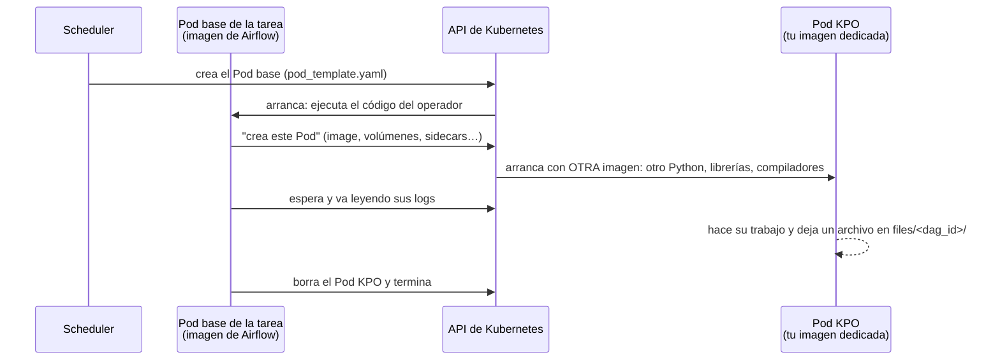
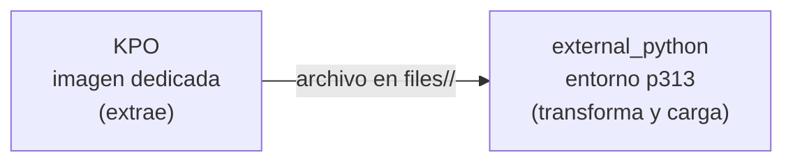

# 14 · Imágenes dedicadas con KubernetesPodOperator

`@task.external_python` cubre el 95 % de los casos. El resto son tareas que **no pueden**
correr en la imagen de Airflow ni en el entorno Conda, por ejemplo:

- Un stack nativo que solo compila con otra versión de Python o del SO (drivers
  propietarios, SASL/Kerberos para Hive/Impala, SDKs de fabricantes).
- Binarios de sistema (`gdal`, `wkhtmltopdf`, clientes Oracle) que no quieres en la
  imagen base.
- Una herramienta ya empaquetada por otro equipo (dbt, un scraper, un modelo de ML).

Para eso: **`KubernetesPodOperator` (KPO) con una imagen dedicada**, y el patrón
*extraer a archivo → procesar con `external_python`*. Ejemplo ejecutable:
[`dags/example_kpo`](../dags/example_kpo/) (con y sin `pod_template_file`, listo para
clústeres con y sin RBAC).

## 1. Cómo funciona por dentro

La tarea KPO **no** corre "dentro" de otro Pod. Son dos Pods **hermanos**:



Comprobado en un clúster real (MicroK8s, Airflow 3.2.1) con los dos Pods vivos a la vez:

| | Pod base de la tarea | Pod KPO |
|---|---|---|
| Imagen | `airflow-k8s-base` (Python 3.12) | `python:3.11-slim` (Python 3.11) |
| IP | propia | **otra** IP |
| `ownerReferences` | — | ninguna: no "cuelga" del Pod base |
| Procesos | solo los de Airflow (`execute_workload`) | solo el proceso de tu imagen |
| Necesita la API | **sí** (crea el Pod KPO) | no |

Consecuencias:

- La imagen dedicada puede ser **cualquier cosa**: no necesita Airflow ni compartir
  versión de Python con el sistema. La imagen base y el entorno `p313` no se tocan.
- Entre los dos Pods no hay memoria compartida: el resultado viaja por **disco**
  (`files/<dag_id>/`) o lo lee el Pod base de los logs.
- El Pod base necesita **permiso para crear Pods** (ver §3).

## 2. Patrón y código



La imagen dedicada hace **solo** lo que exige su stack especial y deja un archivo en
`files/<dag_id>/`; el resto del pipeline sigue el estándar.

```python
from airflow.providers.cncf.kubernetes.operators.pod import KubernetesPodOperator
from kubernetes.client import models as k8s

PROJECT_PATH = "/opt/airflow-platform"  # ruta del HOST (hostPath)

files_volume = k8s.V1Volume(
    name="files",
    host_path=k8s.V1HostPathVolumeSource(path=f"{PROJECT_PATH}/files", type="Directory"),
)
files_mount = k8s.V1VolumeMount(name="files", mount_path="/opt/airflow/files")

# Necesario con RBAC, inofensivo sin él (ver §3): el Pod BASE de esta tarea usa la cuenta
# del worker, que puede crear Pods. No afecta a ninguna otra tarea ni al pod_template global.
KPO_LAUNCHER = {
    "pod_override": k8s.V1Pod(
        spec=k8s.V1PodSpec(
            service_account_name="airflow-worker",  # <HELM_RELEASE>-worker
            containers=[k8s.V1Container(name="base")],
        )
    )
}

extract = KubernetesPodOperator(
    task_id="extract_legacy_source",
    namespace="airflow",
    image="my-legacy-extractor:1.0.0",
    image_pull_policy="Never",  # importada a containerd como la de Airflow
    cmds=["python", "/app/extract.py"],
    arguments=["--date", "{{ ds }}", "--out", "/opt/airflow/files/my_dag/raw_{{ ds }}.csv"],
    volumes=[files_volume],
    volume_mounts=[files_mount],
    security_context=k8s.V1PodSecurityContext(run_as_user=50000),  # mismo UID -> mismos permisos
    container_resources=k8s.V1ResourceRequirements(
        requests={"cpu": "250m", "memory": "1Gi"}, limits={"cpu": "1", "memory": "4Gi"}
    ),
    get_logs=True,
    on_finish_action="delete_pod",
    executor_config=KPO_LAUNCHER,
)

extract >> transform_with_external_python(...)
```

Construye e importa la imagen igual que la de Airflow:

```bash
docker build -t my-legacy-extractor:1.0.0 images/legacy-extractor/
docker save my-legacy-extractor:1.0.0 | sudo microk8s ctr image import -
```

> Credenciales: pásalas como `env_vars` desde un **Secret** de Kubernetes
> (`k8s.V1EnvVar(value_from=...secret_key_ref...)`) o resuélvelas en una tarea previa;
> nunca en `arguments` (quedan en la definición del Pod y en los logs).

### Dos plantillas distintas: no confundirlas

| Qué quieres configurar | Dónde | Afecta a |
|---|---|---|
| Cuenta de servicio, labels del Pod que **ejecuta el operador** | `executor_config` (`pod_override` o `pod_template_file`) | Pod **base** |
| Imagen, sidecars, volúmenes, variables del Pod **que hace el trabajo** | argumentos del KPO (`image`, `volumes`, `init_containers`…) o su propio `pod_template_file=` | Pod **KPO** |

- `executor_config` **no sirve para cambiar la imagen** de una tarea: para otra imagen,
  usa un KPO.
- `KubernetesPodOperator(pod_template_file="/opt/airflow/pod_templates/mi_plantilla.yaml")`
  toma ese YAML como base del Pod KPO y le aplica encima los argumentos (`image`,
  `volumes`…). Útil cuando el Pod KPO es complejo (sidecars, volúmenes en memoria): el
  YAML queda versionado aparte y el DAG queda corto. El archivo lo lee el **Pod base**,
  así que debe estar en `k8s/pod_templates/` (montado en `/opt/airflow/pod_templates`),
  y su contenedor principal debe llamarse `base`.

## 3. Permisos: con RBAC y sin RBAC

El Pod base llama a la API para crear el Pod KPO, y eso requiere permiso. **Esta
plataforma instala MicroK8s con RBAC ACTIVADO** (`scripts/install_microk8s.sh`, línea
`for addon in dns hostpath-storage rbac metrics-server`). Con RBAC activado, el Pod de una
tarea usa la cuenta `default`, que **no** puede crear Pods. Para usar KPO elige un camino:

| | **A. Mantener RBAC** (recomendado) | **B. Desactivar RBAC** (más simple) |
|---|---|---|
| Qué haces | Agregas `executor_config=KPO_LAUNCHER` a cada tarea KPO | Nada en los DAGs |
| Dónde se configura | En el **DAG**, en la propia tarea (§2; ejemplo en [`dags/example_kpo/_dag.py`](../dags/example_kpo/_dag.py)) | Antes de instalar: quitar `rbac` de esa línea de `scripts/install_microk8s.sh`. Con el clúster ya instalado: `sudo microk8s disable rbac` |
| Resultado | Solo esas tareas pueden crear Pods | Todo está permitido para todos (modo `AlwaysAllow`) |

`KPO_LAUNCHER` funciona en los dos modos: si lo pones siempre, tus DAGs no dependen de
cómo esté configurado el clúster. Para saber en qué modo está un clúster:

```bash
sudo grep -q -- '--authorization-mode=.*RBAC' /var/snap/microk8s/current/args/kube-apiserver \
  && echo "RBAC: SÍ" || echo "RBAC: NO (AlwaysAllow)"
microk8s kubectl auth can-i create pods -n airflow --as=system:serviceaccount:airflow:default
```

Qué implica cada modo (verificado en MicroK8s):

| | **RBAC activado** (por defecto) | **RBAC desactivado** (`AlwaysAllow`) |
|---|---|---|
| KPO | Requiere `executor_config=KPO_LAUNCHER` en cada tarea KPO (§2). Sin él: `403 Forbidden: User "system:serviceaccount:airflow:default" cannot list resource "pods"` | Funciona sin configurar nada |
| CronJobs de `k8s/cronjobs/` | Funcionan (sus manifiestos traen sus propios permisos) | Funcionan |
| Seguridad | Cada componente puede hacer solo lo suyo | **Cualquier tarea de cualquier DAG puede hacer cualquier cosa en el clúster**: leer Secrets (keytabs, credenciales), borrar los Pods de Airflow o PostgreSQL, crear Pods privilegiados |
| Si se cambia de modo | — | Activar RBAC después **rompe con 403 todas las tareas KPO** que no tengan `KPO_LAUNCHER`: agrégalo antes |

Las tareas normales (`@task`, `external_python`) no llaman a la API y funcionan igual en
ambos modos. Solo las que lanzan Pods necesitan la cuenta del worker.

Detalles verificados:

- `pod_override` y `pod_template_file` en `executor_config` **sí** se aplican al Pod real
  (Airflow 3.2.1, provider `cncf-kubernetes` 10.16.0). En versiones antiguas la pestaña
  *K8s Pod Spec* de la UI mostraba siempre la plantilla global aunque el Pod usara la
  otra ([apache/airflow#46373](https://github.com/apache/airflow/issues/46373)): verifica
  con `kubectl get pod <pod> -o yaml`, no con la UI.
- **No actualices el cliente `kubernetes` a 36.x** mientras siga abierto
  [apache/airflow#68827](https://github.com/apache/airflow/issues/68827): con él, toda
  tarea con `pod_override` tumba el scheduler en bucle (`PicklingError`). La imagen se
  construye con las *constraints* oficiales, que fijan la 35.x.

## 4. Ejemplo típico: Hive/Impala con Kerberos (sidecar)

Un caso frecuente: extraer de un Hive o Impala protegido con Kerberos suele exigir un
stack SASL en C (`sasl`, `pyhive`, `thrift` en versiones exactas) que puede no compilar
con Pythons recientes (p. ej. solo con 3.10). El patrón:

- **Imagen dedicada** `FROM apache/airflow:<ver>-python3.10` + toolchain + `krb5` + el
  stack SASL fijado. **No se "actualiza" a 3.12**: rompe SASL.
- **Keytab en un Secret** y **`krb5.conf` en un ConfigMap**, nunca en la imagen ni en git:

  ```bash
  kubectl create secret generic svc-keytab --from-file=svc.keytab=./svc.keytab -n airflow
  kubectl create configmap krb5-config --from-file=krb5.conf=./krb5.conf -n airflow
  ```

- **Sidecar de renovación de tickets:** un contenedor que hace `kinit -kt` en bucle y
  comparte el caché de tickets (`KRB5CCNAME` en un `emptyDir` en memoria) con el
  contenedor principal. Así las extracciones largas no fallan por ticket expirado. Lo
  más limpio es un *sidecar nativo* (`initContainers` con `restartPolicy: Always`, K8s ≥
  1.29) en el `pod_template_file` del propio KPO (§2): probado con esa forma, el
  contenedor principal lee el ticket que dejó el sidecar.
- Si los Pods no resuelven el DNS interno de tu red, `krb5.conf` con los KDC por IP y
  `dns_lookup_kdc = false`.
- Un **pool** dedicado (p. ej. 2 slots) para no saturar el clúster Hive.
- Con RBAC activado, el `executor_config=KPO_LAUNCHER` de §2.

Síntomas típicos y su capa: `Permission denied` leyendo el keytab (UID/permisos del
Secret: `defaultMode: 0440` + `fsGroup`), `Cannot find KDC` (krb5.conf/DNS),
`Clock skew too great` (NTP), `GSS initiate failed` (principal/realm), `TTransportException`
(versión de thrift/sasl). Resuélvelos en ese orden: son capas.

Si tienes varias extracciones de este tipo, encapsula la construcción del KPO (volúmenes,
Secret, sidecar, recursos, `executor_config`) en una función de `libs/` para que el DAG
solo pase la query.

## 5. Cuándo NO usar KPO

- Si la librería se puede instalar en el entorno Conda → `external_python` (más simple,
  arranca más rápido, comparte helpers de `libs/`).
- Para "aislar" una tarea normal → ya está aislada: es su propio Pod.
